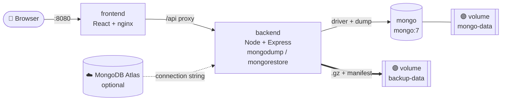

### 📦 Public container images

[](https://hub.docker.com/r/agadhk/mongo-backup-backend)
[](https://hub.docker.com/r/agadhk/mongo-backup-frontend)
[](https://quay.io/repository/agadhk/mongo-backup-backend)
[](https://quay.io/repository/agadhk/mongo-backup-frontend)

```bash
# Docker Hub
podman pull docker.io/agadhk/mongo-backup-backend:latest
podman pull docker.io/agadhk/mongo-backup-frontend:latest

# Quay.io
podman pull quay.io/agadhk/mongo-backup-backend:latest
podman pull quay.io/agadhk/mongo-backup-frontend:latest
```
<div align="center">

# ⚡ MongoBackup · Podman

### Automated MongoDB backup, guarded delete and one-click recovery, running in rootless Podman containers


**Pick an interval. Pick a database. Never lose a document again.**

</div>

---

## ✨ Features

| | Feature | What it does |
|---|---|---|
| 🔌 | **Connect anywhere** | Paste a connection string (Podman MongoDB or MongoDB Atlas), Compass style |
| 🗄️ | **Database browser** | Browse every database, collection and document |
| ⏱️ | **Interval backups** | Back up every *N* hours or minutes, for one database or all of them |
| 🛡️ | **Backup badges** | Every document shows `✔ in backup` or `⚠ not backed up` |
| 🚫 | **Guarded delete** | Deleting an unprotected document warns you and offers *back up first* |
| ♻️ | **Recovery tab** | Finds documents deleted from MongoDB that still exist in a backup and restores them |
| 📦 | **Restore and download** | Restore any archive, or download the `.gz` file |
| 🎬 | **Animated UI** | Boot-up splash, live backup pipeline, countdown ring, dark and light themes |
| 🐧 | **Podman-first** | Rootless containers, named volumes, a custom network, SELinux `:Z` labels |

---

## 🏗️ Architecture



| Container | Image | Port | Volume |
|---|---|---|---|
| `frontend` | `quay.io/agadhk/mongo-backup-frontend` | `8080 → 80` | none |
| `backend` | `quay.io/agadhk/mongo-backup-backend` | `5000` | `backup-data → /backups` |
| `mongo` | `docker.io/library/mongo:7` | `27017` (internal) | `mongo-data → /data/db` |

All three containers share the Podman network **`mernnet`**, and DNS lets them find each other by name (`mongo`, `backend`).

---

## 💾 How a backup works

1. The scheduler fires, or the user clicks **Backup now**.
2. The backend builds a **manifest**: the `_id` of every document per collection.
3. It runs `mongodump --archive --gzip` against the `mongo` container over the Podman network.
4. The archive is written to `/backups`, which **is the `backup-data` volume**.
5. The manifest `.json` is saved beside it, and `settings.json` is updated.

```
mongo container ──(network + mongodump)──▶ backend container ──(/backups)──▶ 🟣 backup-data volume
```

**Why volumes?** Backups live outside the database container and outside the backend container. You can delete, rebuild or replace any container and the backups remain.

| File in `backup-data` | Meaning |
|---|---|
| `backup-<time>-<auto\|manual>-<db>.gz` | compressed `mongodump` archive |
| `backup-<time>-....json` | manifest of document `_id`s in that backup |
| `settings.json` | interval, database, last run |
| `deletions.json` | log of deleted documents (saved or lost) |

---

## 🚀 Quick start

### Option A: build locally

```bash
git clone <your-repo-url>
cd db_linux_backup
chmod +x run.sh
./run.sh
```

Open **http://localhost:8080**, click **Podman mongo container**, then **+ Add data**.

> 🪟 **Windows:** run `podman machine start` first, and use **Git Bash** for `./run.sh`.

### Option B: pull the ready-made images (RHEL, Fedora, any Podman host)

```bash
podman network create mernnet
podman volume create mongo-data
podman volume create backup-data

podman run -d --name mongo --network mernnet \
  -v mongo-data:/data/db:Z docker.io/library/mongo:7

podman run -d --name backend --network mernnet \
  -v backup-data:/backups:Z -p 5000:5000 \
  quay.io/agadhk/mongo-backup-backend:latest

podman run -d --name frontend --network mernnet \
  -p 8080:80 quay.io/agadhk/mongo-backup-frontend:latest

podman ps
```

Docker Hub copies also exist: `docker.io/agadhk/mongo-backup-backend` and `docker.io/agadhk/mongo-backup-frontend`.

> ⚠️ Keep the container names exactly `mongo`, `backend` and `frontend`. nginx and the backend find each other by name.

---

## 🧭 Using the app

1. **Connect:** use the Podman MongoDB button, or paste a `mongodb://` or `mongodb+srv://` string.
2. **Documents:** browse databases and collections, and check the backup badges.
3. **Backups:** set *every N hours/minutes*, choose a database, click **Start**, or click **Backup now**.
4. **Delete a document:** if it isn't backed up, the app warns you first.
5. **Recovery:** click **Recover** to bring back documents that were deleted but still exist in a backup.

> 💡 For demos, use **1 minute** so you see backups appear quickly.

---

## 🔍 Podman commands worth knowing

```bash
# images
podman images
podman history quay.io/agadhk/mongo-backup-backend:latest

# containers
podman ps -a
podman logs -f backend
podman exec -it backend sh
podman stats --no-stream

# volumes
podman volume ls
podman volume inspect backup-data
ls -lh $(podman volume inspect backup-data --format '{{.Mountpoint}}')

# network
podman network inspect mernnet
podman exec backend getent hosts mongo

# RHEL and security
whoami          # not root = rootless
getenforce      # SELinux mode
```

**Persistence proof:**

```bash
podman rm -f backend mongo     # destroy the containers
podman volume ls               # volumes are still there
# re-run the podman run lines: data and backups are back
```

---

## 🌐 API

| Method | Endpoint | Purpose |
|---|---|---|
| `POST` | `/api/connect` | Connect with a connection string |
| `GET` | `/api/databases` | List databases |
| `GET` | `/api/databases/:db/collections` | List collections |
| `GET` | `/api/databases/:db/collections/:col/docs` | Documents plus backup flags |
| `POST` | `/api/insert` | Insert a document |
| `DELETE` | `/api/databases/:db/collections/:col/docs/:id?mode=safe\|backup\|force` | Guarded delete |
| `GET/POST` | `/api/settings` | Read or set the backup schedule |
| `POST` | `/api/backup` | Backup now |
| `GET` | `/api/backups` | List backups |
| `POST` | `/api/restore/:file` | Restore an archive |
| `GET` | `/api/recovery` | Documents missing from MongoDB but present in a backup |
| `POST` | `/api/recover` | Re-insert selected documents |

---

## 🗂️ Project structure

```
db_linux_backup/
├── backend/
│   ├── Dockerfile        # Node 20 + MongoDB Database Tools
│   ├── package.json
│   └── server.js         # API, scheduler, backup, restore, recovery
├── frontend/
│   ├── src/
│   │   ├── App.jsx       # UI
│   │   └── main.jsx
│   ├── Dockerfile        # multi-stage: Vite build, then nginx
│   ├── nginx.conf        # /api proxy to backend:5000
│   ├── index.html
│   ├── package.json
│   └── vite.config.js
└── run.sh                # network, volumes, build, run
```

---

## 🧩 Troubleshooting

| Problem | Fix |
|---|---|
| `Cannot connect to Podman` (Windows) | `podman machine start` |
| `name already in use` | `podman rm -f frontend backend mongo`, then rerun |
| Blank page or 502 | `podman restart frontend`, then `Ctrl+Shift+R` |
| `ECONNREFUSED 127.0.0.1:27017` | `localhost` inside a container is the container. Use `mongo:27017` |
| Atlas: *Server selection timed out* | Allow your IP in Atlas, and check that your network allows port 27017 |
| `bad interpreter` or `^M` | `sed -i 's/\r$//' run.sh` |
| `pull access denied` | Make the Docker Hub or Quay repository **Public** |

---

## ⚠️ Limitations

- A document added and deleted **between two backups** can't be recovered, because it was never captured.
- Backups run only while the containers and the host are running.
- There is no login, so use it on a trusted network and don't expose it to the internet.
- Restore uses `--drop`, which replaces collections. Test on a copy first.

## 🔮 Future work

Login and roles · change-stream capture for point-in-time recovery · backup retention rules · encrypted off-site copies · systemd Quadlet auto-start on RHEL · email or Slack alerts

---

## 👥 Team

| Register No. | Name |
|---|---|
| RA2411026011299 | Agadh Khanolkar |
| RA2411033010017 | Kushagra Agarwal |
| RA2411033010024 | Arnav Kumar |

<div align="center">

SRM Institute of Science and Technology · School of Computing

Made with 🐧 Podman and 🍃 MongoDB

</div>